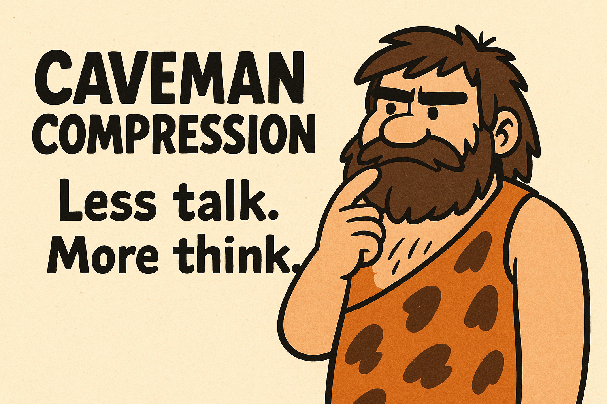
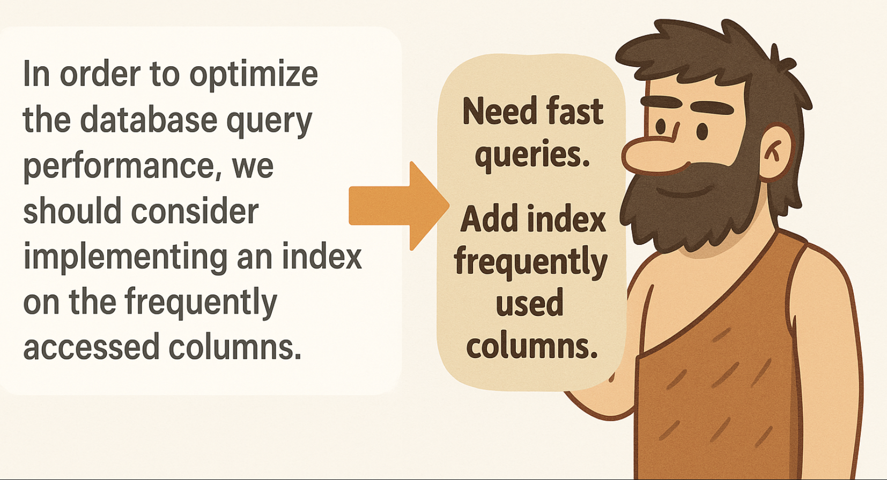

<div align="center">



**Lossless semantic compression for LLM contexts**

[](https://opensource.org/licenses/MIT)
[](https://www.python.org/downloads/)

[Quick Start](#quick-start) • [Examples](#examples) • [Benchmarks](#benchmarks) • [Spec](SPEC.md)

</div>

---

## What is this?

Strip grammar. Keep facts. Save tokens.

```diff
- "In order to optimize the database query performance, we should consider implementing an index on the frequently accessed columns..." (70 tokens)
+ "Need fast queries. Check which columns used most. Add index to those columns..." (50 tokens)

= 29% reduction
```

---

## How It Works



LLMs excel at filling linguistic gaps. They predict missing grammar, connectives, and structure.

**Key insight:** We remove only what LLMs can reliably reconstruct.

**What we remove (predictable):**
- Grammar: "a", "the", "is", "are"
- Connectives: "therefore", "however", "because"
- Passive constructions: "is calculated by"
- Filler words: "very", "quite", "essentially"

**What we keep (unpredictable):**
- Facts: numbers, names, dates
- Technical terms: "O(log n)", "binary search"
- Constraints: "medium-large", "frequently accessed"
- Specifics: "Stockholm", "99.9% uptime"
- Negations: "not", "never", "cannot", "don't", "n't" (removing these would invert meaning)
- ALL-CAPS tokens (opt-in): user-defined escape hatch for critical terms like "DANGER"

```
Compressed: "Company medium-large. Location Stockholm."
Decompressed: "at a medium-large company based in Stockholm"
           ↑ grammar added, facts unchanged ↑
```

---

## Quick Start

### Installation

**LLM-based (best compression, requires OpenAI API):**
```bash
python3 -m venv venv
source venv/bin/activate
pip install -r requirements.txt

# Set up API key
cp .env.example .env
# Edit .env and add your OpenAI API key
```

**NLP-based (free, offline, multilingual):**
```bash
python3 -m venv venv
source venv/bin/activate
pip install -r requirements-nlp.txt
python -m spacy download en_core_web_sm  # or other language models
```

**MLM-based (free, offline, predictability-aware):**
```bash
python3 -m venv venv
source venv/bin/activate
pip install -r requirements-mlm.txt
python -m spacy download en_core_web_sm
```

### Usage

**NLP-based compression (most stable, 15-30% reduction, free, offline):**
```bash
python caveman_compress_nlp.py compress "Your verbose text here"
python caveman_compress_nlp.py compress -f input.txt -o output.txt
python caveman_compress_nlp.py compress -f input.txt -l es  # specify language
```

**MLM-based compression (20-30% reduction, free, offline, predictability-aware):**
```bash
python caveman_compress_mlm.py compress "Your verbose text here"
python caveman_compress_mlm.py compress -f input.txt -o output.txt
python caveman_compress_mlm.py compress -f input.txt -p 1e-4  # adjust probability threshold
```

**LLM-based compression (40-58% reduction, requires API key):**
```bash
python caveman_compress.py compress "Your verbose text here"
python caveman_compress.py compress -f input.txt -o output.txt
```

**Decompress:**
```bash
python caveman_compress.py decompress "Caveman text here"
```

---

## Examples

### Resume

<table>
<tr>
<td width="50%"><b>Normal (201 tokens)</b></td>
<td width="50%"><b>Caveman (156 tokens)</b></td>
</tr>
<tr>
<td>

I am John Smith, a 32-year-old Senior Software Engineer at a large enterprise software company based in San Francisco, California. I have over 8 years of experience in backend development, distributed systems, and database optimization. Throughout my career, I have successfully designed and implemented scalable microservices...

</td>
<td>

John Smith. 32 years old. Senior Software Engineer. Large enterprise software company. San Francisco, California. 8 years experience. Backend development, distributed systems, database optimization. Designed scalable microservices. 50 million requests daily...

</td>
</tr>
<tr>
<td colspan="2" align="center"><b>22% reduction</b></td>
</tr>
</table>

### System Prompt

<table>
<tr>
<td width="50%"><b>Normal (171 tokens)</b></td>
<td width="50%"><b>Caveman (72 tokens)</b></td>
</tr>
<tr>
<td>

You are a helpful AI assistant designed to provide accurate and concise responses to user queries. When answering questions, you should always prioritize clarity and correctness over speed. If you are uncertain about any information, you must explicitly state your uncertainty...

</td>
<td>

Helpful AI assistant. Provide accurate, concise responses. Prioritize clarity, correctness. If uncertain, state uncertainty. Break complex problems into smaller steps. Explain reasoning clearly...

</td>
</tr>
<tr>
<td colspan="2" align="center"><b>58% reduction</b></td>
</tr>
</table>

### API Documentation

<table>
<tr>
<td width="50%"><b>Normal (137 tokens)</b></td>
<td width="50%"><b>Caveman (79 tokens)</b></td>
</tr>
<tr>
<td>

To authenticate with our API, you need to include your API key in the Authorization header of every request. The API key should be prefixed with the word "Bearer" followed by a space. If authentication fails, the server will return a 401 Unauthorized status code...

</td>
<td>

Authenticate API. Include API key in Authorization header every request. Prefix API key with "Bearer" space. Authentication fail, server return 401 Unauthorized status code, error message explain fail...

</td>
</tr>
<tr>
<td colspan="2" align="center"><b>42% reduction</b></td>
</tr>
</table>

---

## Benchmarks

### Factual Preservation

Automated benchmark verifying that specific facts are preserved and retrievable after compression:

```bash
# LLM-based compression
python benchmark/factual_preservation/run_factual_benchmark.py

# NLP-based compression
python benchmark/factual_preservation/run_factual_benchmark_nlp.py
```

**Results:** 13/13 facts preserved (100%) with 12-25% compression ratio.

See [benchmark/factual_preservation/](benchmark/factual_preservation/) for details.

### Example Reductions

| Test Case | Original | Compressed | Reduction |
|-----------|----------|------------|-----------|
| System prompt | 171 tokens | 72 tokens | **58%** |
| API documentation | 137 tokens | 79 tokens | **42%** |
| Resume | 201 tokens | 156 tokens | **22%** |
| **Average** | **170** | **102** | **40%** |

All examples validated with GPT-4o. See [examples/](examples/) for full text.

---

## Core Principles

1. **Strip connectives** - Remove: therefore, however, because, in order to
2. **2-5 words per sentence** - One atomic thought per sentence
3. **Action verbs** - Prefer: do, make, fix, check vs facilitate, optimize
4. **Be concrete** - "test five, test six" not "test values 5-6"
5. **Active voice** - "calculate value" not "value is calculated"
6. **Keep meaningful info** - Numbers, sizes, names, constraints stay

See [SPEC.md](SPEC.md) for full rules.

---

## Use Cases

### RAG Knowledge Base (199→118 tokens, 41%)

**Original:**
> A network router is a device that forwards data packets between computer networks. Routers perform the traffic directing functions on the Internet. When a data packet arrives at a router, the router examines the destination IP address...

**Compressed:**
> Network router forwards data packets. Routers direct Internet traffic. Packet arrives router. Router examines destination IP address. Router determines best path. Router uses routing table...

**Why it works:** Store compressed docs in vector DB. Agent receives compressed RAG results directly. No decompression needed—agent understands caveman format. Fits 2-3x more context.

### Agent Internal Reasoning (196→102 tokens, 48%)

**Original:**
> First, I need to understand what the user is asking for. They want to calculate the optimal route between two cities considering both distance and traffic conditions. Let me break this down into steps. Step one: I should identify the starting city...

**Compressed:**
> Need understand user request. User wants optimal route between cities. Consider distance, traffic. Step one: Identify starting city, destination city. Step two: Retrieve current traffic data for routes...

**Why it works:** Agent thinks in caveman format during problem-solving. Chain-of-thought uses 50% fewer tokens. More reasoning steps fit in context window.

---

## Compression Methods

### LLM-based (`caveman_compress.py`)
- **Reduction:** 40-58%
- **Cost:** Requires OpenAI API key
- **Quality:** Best compression, context-aware
- **Speed:** ~2s per request
- **Use when:** Maximum token savings needed

### MLM-based (`caveman_compress_mlm.py`)
- **Reduction:** 20-30%
- **Cost:** Free
- **Quality:** Excellent compression, predictability-aware using RoBERTa
- **Speed:** ~1-5s per document (local model)
- **Method:** Removes tokens whose masked language model probability exceeds a configurable threshold (default `P >= 1e-5`)
- **Use when:** Need better compression than NLP without API costs, can tolerate model download (~500MB) and initial loading time

### NLP-based (`caveman_compress_nlp.py`)
- **Reduction:** 15-30%
- **Cost:** Free
- **Quality:** Good compression, rule-based
- **Speed:** <100ms
- **Languages:** 15+ supported (en, es, de, fr, it, pt, nl, el, nb, lt, ja, zh, pl, ro, ru, and more)
- **Use when:** Working offline, processing large volumes, no API budget, or need multilingual support

---

## Safety Preservation

The MLM-based and NLP-based compressors apply two safety rules that override
normal removal decisions. These prevent compression from silently inverting
meaning or stripping terms the user has explicitly marked as critical.

### Negation Protection (on by default)

Negation tokens are preserved unconditionally. Removing them inverts the
meaning of the surrounding sentence, which is unacceptable for any
production use.

Protected tokens (case-insensitive):
`no`, `not`, `never`, `none`, `nobody`, `nothing`, `nowhere`, `neither`, `nor`,
`without`, `cannot`, `n't`, and the common contractions (`don't`, `doesn't`,
`didn't`, `won't`, `wouldn't`, `shouldn't`, `couldn't`, `can't`, `isn't`,
`aren't`, `wasn't`, `weren't`, `hasn't`, `haven't`, `hadn't`, `mustn't`,
`shan't`, `ain't`).

Disable with `--no-protect-negations` if you have an unusual use case that
requires removal of negations.

```bash
python caveman_compress_nlp.py compress "You should never delete prod without a backup."
# → "Never delete prod without backup."   (negations preserved)
```

### ALL-CAPS Escape Hatch (opt-in)

When enabled with `--protect-all-caps`, any token consisting of ≥2 uppercase
letters is preserved verbatim regardless of predictability or stop-word
status. This gives teams a stable wrapper they can use to mark domain-critical
terms that must survive compression.

```bash
python caveman_compress_nlp.py compress --protect-all-caps "The DANGER flag must remain set."
# → "DANGER flag remain set."
```

Pair with a simple pre-filter to capitalize project-specific terms before
compression — e.g. piping through `sed` to upcase `PROD`, `STAGING`, or
custom safety markers.

Applies to: `caveman_compress_mlm.py`, `caveman_compress_nlp.py`. The
LLM-based compressor relies on prompt instructions rather than these flags.

---

## When to Use

✅ **Good for:**
- LLM reasoning/thinking blocks
- Token-constrained contexts
- Internal documentation
- Step-by-step instructions

❌ **Avoid for:**
- User-facing content
- Marketing copy
- Legal documents
- Emotional communication

---

## Documentation

- [SPEC.md](SPEC.md) - Full specification and rules
- [examples/](examples/) - Before/after samples
- [benchmark/](benchmark/) - Semantic losslessness tests
- [prompts/compression.txt](prompts/compression.txt) - System prompt for compression
- [prompts/decompression.txt](prompts/decompression.txt) - System prompt for decompression

---

## Contributing

Contributions welcome. Submit issues or PRs.

---

## License

MIT

---

## Author

**William Peltomäki**

---

Inspired by [TOON](https://github.com/toon-format/toon) and the token-optimization movement.
